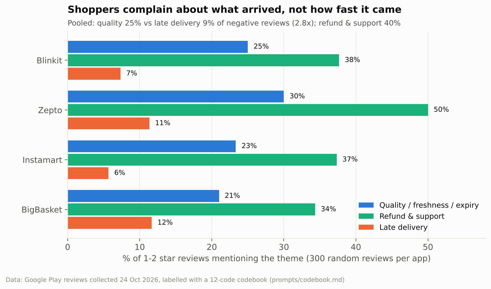
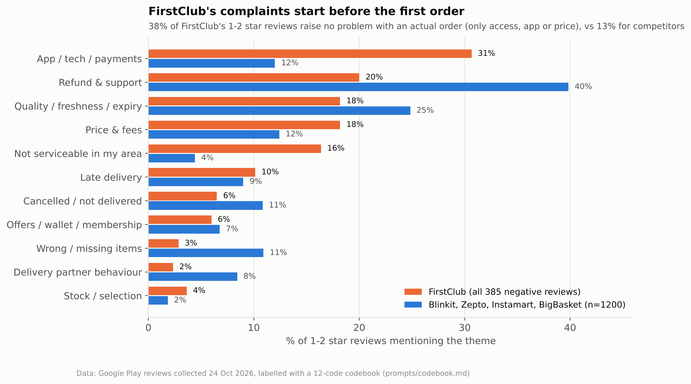
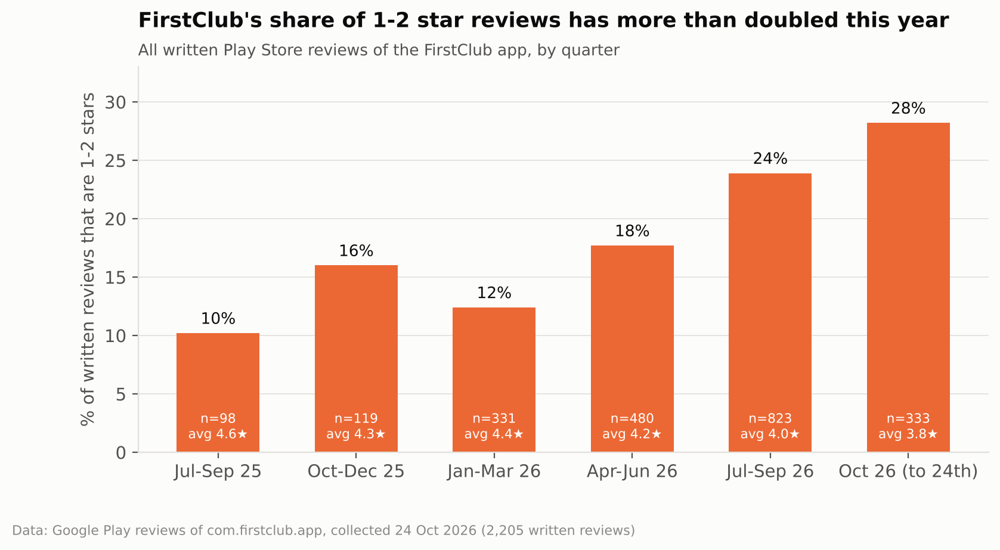
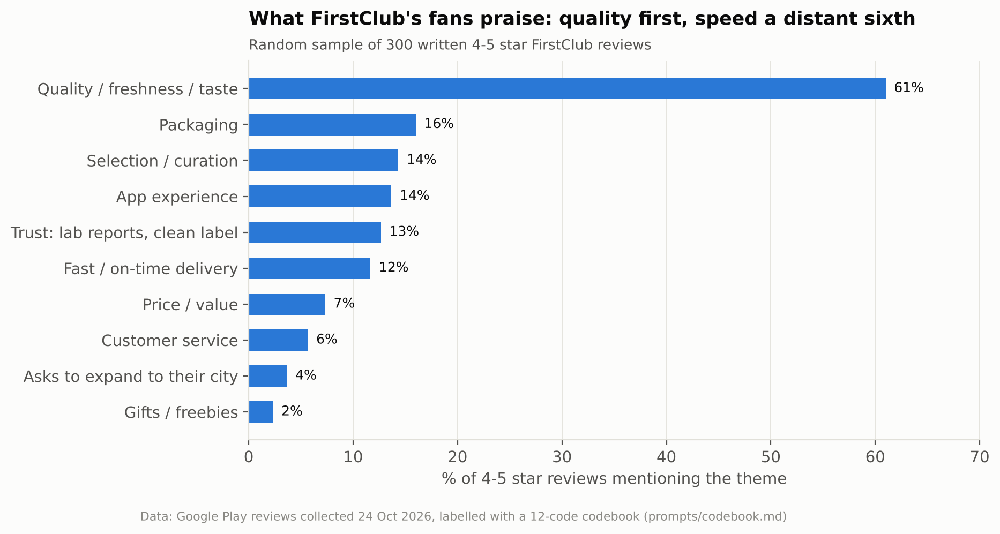

# The Quick-Commerce Trust Gap
### What 26,205 Play Store reviews say about Blinkit, Zepto, Instamart, BigBasket and FirstClub

**Question:** FirstClub's bet is that Indian grocery shoppers want *quality and trust* more than *speed*. Do customers' own complaints back that up? And what are FirstClub's own reviews telling it right now?

**Method:**
- **Collection:** I collected the most recent public Google Play reviews on 24 Oct 2026: every written FirstClub review (2,205) plus the newest 6,000 for each competitor.
- **Codebook:** I built a 12-theme complaint codebook.
- **Labelling:** 1,885 reviews were labelled with an LLM: all 385 FirstClub 1–2★ reviews, 300 random 1–2★ reviews per competitor, and 300 FirstClub 4–5★ reviews.
- **Check:** I compared the labels against an independent keyword classifier.
- **Output:** the findings turn into two PRDs.

---

## Key findings

### 1. Across the market, shoppers complain about *what arrived*, not *how fast*


Across 1,200 one- and two-star competitor reviews:
- **Quality, freshness or expiry:** 24.8% (95% CI 22.5–27.4%).
- **Late delivery:** 9.0% (7.5–10.8%), so quality complaints are **2.8×** as common.
- **Refund & support:** 40% of complaints, the biggest theme of all. The anger is about a bad item *plus* no fix.
- **Post-purchase trust failures** (bad quality, wrong or missing items, non-delivery, refund/support): **54–67%** of each competitor's negative reviews, vs **6–12%** for lateness.
- **So:** speed is table stakes. The pain point is trust after the order, which is exactly the gap FirstClub is positioned on.

### 2. FirstClub's 1–2★ reviews are different: many people never get to a first order


FirstClub's top complaint themes are the reverse of the market's:
- **App, login and payments:** 31%.
- **Price & fees:** 18%.
- **"Not serviceable in my area":** 16%, vs 4% for competitors.

**38% of FirstClub's negative reviews raise no problem with an actual order**, only access, the app or price. For competitors it is 13%. Of the 63 "unserviceable" reviews:
- **18** explicitly say they had already signed up, answered onboarding questions or built a cart before learning the app doesn't deliver to them.
- **8** mention seeing FirstClub ads anyway.
- One reviewer: *"Spent a lot of time and added items to the cart and while adding address and making payment it says the area is not serviceable."*

These are cheap 1★ reviews to prevent → **[PRD 1: Serviceability-first onboarding](PRD_1_serviceability_first_onboarding.md)**.

### 3. FirstClub's rating is sliding as it scales, with post-order complaints rising fastest


- **Rating slide:** the share of FirstClub's written reviews that are 1–2★ rose from **12% (Jan–Mar 2026) to 28% (1–24 Oct 2026)**. The average fell from 4.4★ to 3.8★.

Complaints per 100 reviews, before April 2026 vs Jul–Oct 2026:

| Theme | Before Apr 2026 | Jul–Oct 2026 |
|---|---|---|
| Refund & support | 2.3 | 4.5 |
| Quality / freshness / expiry | 1.6 | 3.8 |
| Late delivery | 0.4 | 2.4 |

- **Early-orders pattern:** 12 reviews describe it directly, e.g. *"First two orders were smooth… From the third one, it has been an ordeal."* That is the window where, in my [retention analysis](https://github.com/Yuvraj-Singh-Shehrawat/grocery-retention-lifecycle), habits form (orders 1–5).

### 4. Fans buy quality and trust; speed is a distant sixth


In 300 random 4–5★ FirstClub reviews:
- **61%** praise quality or freshness.
- **13%** praise trust and transparency (lab reports, clean labels).
- **12%** mention fast delivery.
- **Implication:** quality is both the #1 reason people love FirstClub and a rising complaint. That makes visible, verifiable quality the highest-leverage product surface → **[PRD 2: Quality Receipt + 1-tap freshness guarantee](PRD_2_quality_receipt.md)**.

---

## How much to trust the labels
- **Labelling:** an LLM (Claude) labelled the reviews against [`prompts/codebook.md`](prompts/codebook.md). [`src/classify_llm.py`](src/classify_llm.py) re-runs the same prompt with Gemini.
- **Independent check:** a transparent keyword classifier ([`src/keyword_baseline.py`](src/keyword_baseline.py)) agrees with the LLM labels at **Cohen's κ = 0.69 for quality, 0.59 for late delivery, 0.81 for refund & support, 0.83 for price**, and 0.51–0.69 for the rest.
- **Robustness:** the two methods put quality at 23% vs 22% of negative reviews and lateness at 9.3% vs 9.2%. The headline does not depend on the classifier.
- **Human validation (to do):** [`validation/hand_label_150.csv`](validation/hand_label_150.csv) holds 150 reviews (30 per app) for blind hand-labelling. [`src/agreement.py`](src/agreement.py) computes κ against the LLM.

## Limitations
- **Not a random sample of customers:** Play Store reviewers skew towards strong opinions. The comparisons *between themes and apps* are more reliable than the absolute levels.
- **Different time windows:** the newest 6,000 reviews span 5 days for Blinkit and about 5 weeks for the others.
- **FirstClub reviews include non-customers:** that is the point of finding 2, but it means FirstClub's theme mix is not purely about orders.

## Repo structure
```
data/play_reviews_2026-10-24.csv.gz  26,205 reviews (no reviewer names or IDs)
data/labelled_reviews.csv            1,885 labelled reviews: codes (main theme first)
prompts/codebook.md                  the 12 complaint codes + 11 praise codes + LLM prompt
src/collect_reviews.py               re-collect reviews (google-play-scraper)
src/draw_sample.py                   seeded labelling sample
src/classify_llm.py                  LLM labelling with the codebook (Gemini)
src/keyword_baseline.py              independent keyword classifier + kappa vs LLM
src/analyze.py                       all tables (outputs/) and charts (charts/)
src/agreement.py                     kappa between your hand labels and the LLM
validation/hand_label_150.csv        blind hand-labelling sheet
PRD_1_serviceability_first_onboarding.md
PRD_2_quality_receipt.md
```

## How to run
```bash
pip install pandas numpy statsmodels scikit-learn matplotlib
python src/keyword_baseline.py
python src/analyze.py
```
